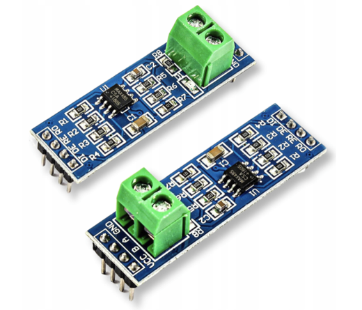

# ESPHome Awenta Pro Auros / Compit C14 Component

An ESPHome external component for **Awenta Pro Auros** heat-recovery ventilation units (recuperators) powered by the **Compit Aero 4A2** controller and **Compit NANO COLOR 2** touch panel over the proprietary **Compit C14 (RS-485 / M.Bus)** protocol.

## Key Features

- **Full Two-Way Control Without Replacing the Display Panel:**
  Unlike approaches that disconnect the display panel or downgrade it to Slave mode, `awenta_auros` keeps your original **NANO COLOR 2** panel as the **Master** (`Address 41`) and communicates with it using the official **Compit iNext (`Address 112`)** time slot (`F0 44`).
- **Silent State-Diff Synchronization (`desired != current`):**
  The ESP32 listens passively to the C14 bus at all times. It only transmits a `'W'` write packet inside the ~880 ms silence window after `F0 44` when a setting changed in Home Assistant differs from the current state reported by the panel. Up to 6 changed registers are batched into a single frame with automatic retry until confirmed.
- **Native Home Assistant `climate` Entity:**
  Exposes a full thermostat card with room temperature, room humidity, target temperature slider, season modes (`Heat` / `Fan only` / `Cool`), fan modes (`Off` / `Low` / `Medium` / `High` / `Diffuse` / `Auto`), and presets (`Eco` / `Boost` / `Home`).
- **Complete Sensor & Control Suite:**
  Dedicated `climate`, `fan`, `select`, `switch`, `number`, `sensor`, `binary_sensor`, and `text_sensor` platforms for every recuperator parameter (including Airing, Fireplace mode, GHE pre-heater, Bypass mode, and all 5 temperature setpoints).

---

## Tested Hardware & Compatibility

### Tested & Verified On
- **Awenta Pro Auros 305** heat-recovery ventilation unit, which comes factory-equipped with:
  - **Compit Aero 4A2** (`AERO 4A ver.2`) internal controller board (C14 bus address `99`)
  - **Compit NANO COLOR 2** (firmware **v6.02**) built-in touch display panel acting as the C14 bus `Master` (address `41`)

### Expected to Work With (Untested)
Because Awenta Pro and several other Polish HVAC brands use the same OEM **Compit Aero 4A2** controller and **Compit NANO COLOR 2** panel, this component should also be compatible with:
- **Awenta Pro Auros** series: **Auros 305, 405, 505, 605** (and **Aquila 305** / **Vena** units equipped with the `Aero 4A2` + `NANO COLOR 2` controller set).
- Other heat-recovery ventilation units built on the **Compit Aero 4 / Aero 4A2** + **Compit NANO COLOR 2** platform over the C14 (`M.Bus`) bus.

*(If you have tested this component with another recuperator model or firmware version, please open an issue or pull request to add it to the list!)*

---

## Hardware & Wiring (RS-485)

### Required Hardware

1. **ESP32 board** (e.g., ESP32-WROOM-32 development board).
2. **MAX485 TTL-to-RS485 transceiver module** with explicit `DE` / `RE` direction control pins:

<p align="center">
  
</p>

> **⚠️ Hardware Compatibility Note (Auto-Direction RS-485 Modules):**
> An automatic RX/TX direction-switching RS-485 converter (commonly sold on Allegro/AliExpress as _"Konwerter RS485 na TTL UART 3.3V 5V zasilany 3-30V half-duplex"_ without `DE`/`RE` pins) was tested on this bus and **failed to read any data from the Compit C14 line**. We strongly recommend using the standard **MAX485 module with manual `DE` + `RE` direction control** shown above.

### Wiring Diagram

The ESP32 + MAX485 transceiver is wired **in parallel** to the existing `C14` (`M.Bus`) 2-wire bus connecting the **Compit Aero 4A2** controller board and the **Compit NANO COLOR 2** display panel (just like an external **Compit iNext** module is connected). Keep your NANO COLOR 2 panel connected and configured as **Master**.

```text
Recuperator (Aero 4A2) /                MAX485 Module                 ESP32 Board
NANO COLOR 2 Panel
┌──────────────────────┐             ┌─────────────────┐           ┌───────────────┐
│                      │             │              RO ├──────────►│ GPIO19 (RX)   │
│        C14 / M.Bus A ├────────────►│ A               │           │               │
│                      │             │              RE ├──┐        │               │
│        C14 / M.Bus B ├────────────►│ B               │  ├───────►│ GPIO21 (Flow) │
│                      │             │              DE ├──┘        │               │
│                  GND ├───────┬────►│ GND             │           │               │
└──────────────────────┘       │     │              DI │◄──────────┤ GPIO18 (TX)   │
                               │     │                 │           │               │
                               │     │             VCC │◄──────────┤ 3.3V / 5V     │
                               │     └─────────────────┘           │               │
                               └──────────────────────────────────►│ GND           │
                                                                   └───────────────┘
```

### Pinout Summary

| MAX485 Module Pin              | Connected To                        | Description                                              |
| ------------------------------ | ----------------------------------- | -------------------------------------------------------- |
| `RO` (Receiver Output)         | ESP32 `GPIO19` (`rx_pin`)           | UART Receive data from MAX485 to ESP32                   |
| `DI` (Driver Input)            | ESP32 `GPIO18` (`tx_pin`)           | UART Transmit data from ESP32 to MAX485                  |
| `DE` + `RE` (bridged together) | ESP32 `GPIO21` (`flow_control_pin`) | Direction control (`HIGH` = Transmit, `LOW` = Receive)   |
| `VCC`                          | ESP32 `3.3V` (or `5V`\*)            | Power supply for the transceiver                         |
| `GND`                          | ESP32 `GND` + Bus `GND`             | Common ground reference                                  |
| `A` / `B` (screw terminal)     | Recuperator `C14` `A` / `B`         | RS-485 differential line (`9600 8N1`), wired in parallel |

_\*Note: If powering the MAX485 module from `5V`, consider using a voltage divider or logic-level shifter on the `RO` → ESP32 `RX` line, or power the module from `3.3V` if your board works reliably at 3.3V._

### 💡 Alternative Option: Dedicated Modbus RTU Port on NANO COLOR 2

According to the official Awenta manual ([_2023.06.16 Instrukcja konfiguracji MODBUS — NANO COLOR 2 + AERO 4A ver.2_](https://www.awenta.pl/user/themes/abootstrap/images/pdf/2023.06.16%20Instrukcja%20konfiguracji%20MODBUS.pdf)), the **Compit NANO COLOR 2** display panel PCB features a **second, independent RS-485 terminal (`MODBUS`: `A`, `B`, `GND`)** that exposes the panel's registers (`1000+` and `2000+`, also listed in [docs/REGISTERS.md](./docs/REGISTERS.md)) over standard **Modbus RTU** (`9600 bps`, default Slave address `44` / register `17`).

This second port has not been tested by the author yet, so its presence on a specific hardware revision should be verified first. However, if your **NANO COLOR 2** panel has the `MODBUS` RS-485 port populated, connecting to it and using ESPHome's built-in `modbus_controller` component may be a simpler alternative to communicating over the proprietary C14 bus.

---

## Quick Start

Add the external component to your ESPHome YAML configuration (see [example.yaml](./example.yaml) for a complete configuration):

```yaml
external_components:
  - source: github://d-lebed/esphome-awenta-auros
    components: [awenta_auros]

uart:
  - id: rs485_bus
    rx_pin: GPIO19
    tx_pin: GPIO18
    baud_rate: 9600

awenta_auros:
  id: awenta_hub
  uart_id: rs485_bus
  flow_control_pin: GPIO21
```

---

## Configuration Reference

### 1. Hub (`awenta_auros`)

```yaml
awenta_auros:
  id: awenta_hub
  uart_id: rs485_bus
  flow_control_pin: GPIO21 # Optional: DE/RE direction control pin for RS-485 transceiver
  time_id: awenta_time # Optional: RealTimeClock ID
```

---

### 2. Climate (`climate`)

```yaml
climate:
  - platform: awenta_auros
    name: "Recuperator"
```

| Climate Attribute            | Home Assistant Option                                       | C14 Mapping                                                                                                                                         |
| ---------------------------- | ----------------------------------------------------------- | --------------------------------------------------------------------------------------------------------------------------------------------------- |
| **Mode** (Season)            | `Heat`<br>`Heat/Cool` (`Auto`) / `Fan only`<br>`Cool`       | Register `64`:<br>`0` = Winter<br>`1` = Summer (mapped to `Heat/Cool` for Apple HomeKit compatibility)<br>`2` = Cooling                             |
| **Preset** (Thermostat Mode) | `Eco`<br>`Boost`<br>`Home`                                  | Register `88`:<br>`0` = Schedule<br>`1` = Party / Holiday<br>`2` = Manual                                                                           |
| **Fan Mode**                 | `Off`<br>`Low`<br>`Medium`<br>`High`<br>`Diffuse`<br>`Auto` | Register `80`:<br>`0` = Off (Gear 0)<br>`1` = Speed 1 (Gear 1)<br>`2` = Speed 2 (Gear 2)<br>`3` = Speed 3 (Gear 3)<br>`4` = Party<br>`5` = Schedule |
| **Target Temperature**       | `10.0 .. 30.0 °C` (step `0.1 °C`)                           | Updates Manual setpoint (Register `6`) and switches Thermostat Mode to `Manual` (Register `88 = 2`)                                                 |

---

### 3. Fan (`fan`)

Provides a dedicated 3-speed fan entity with `Auto` (Schedule) and `Party` preset modes — ideal for **Apple HomeKit** (`Fanv2` service with discrete speeds `33% / 66% / 100%` and `Auto` / `Manual` toggle):

```yaml
fan:
  - platform: awenta_auros
    name: "Recuperator Fan"
```

---

### 4. Selects (`select`)

```yaml
select:
  - platform: awenta_auros
    fan_mode:
      name: "Fan Mode" # Options: Off, Speed 1, Speed 2, Speed 3, Party, Schedule (Reg 80)
    thermostat_mode:
      name: "Thermostat Mode" # Options: Schedule, Party, Manual (Reg 88)
    bypass_mode:
      name: "Bypass Mode" # Options: Off, Auto, On (Reg 79)
```

---

### 5. Switches (`switch`)

```yaml
switch:
  - platform: awenta_auros
    airing:
      name: "Airing" # Airing / ventilation boost (Reg 81: 0=Off, 1=On)
    fireplace:
      name: "Fireplace" # Fireplace mode / positive pressure (Reg 76: 0=Off, 1=On)
    ghe:
      name: "GHE" # Air intake pre-heater (Reg 78: 0=Off, 1=Auto)
```

---

### 6. Setpoint & Fan Speed Numbers (`number`)

Room temperature setpoints support `10.0 .. 30.0 °C` (`0.1 °C` step), `preheater_min_temperature` supports `-10.0 .. 10.0 °C` (`0.5 °C` step, where `-10.0 °C` = `OFF`), and fan speed gear setpoints support `0 .. 100 %` (`1 %` step, `entity_category: config`):

```yaml
number:
  - platform: awenta_auros
    comfort_temperature:
      name: "Comfort Temperature Setpoint" # Reg 3
    eco_winter_temperature:
      name: "Eco Winter Temperature Setpoint" # Reg 4
    eco_cooling_temperature:
      name: "Eco Cooling Temperature Setpoint" # Reg 5
    manual_temperature:
      name: "Manual Temperature Setpoint" # Reg 6
    away_temperature:
      name: "Away Temperature Setpoint" # Reg 7
    preheater_min_temperature:
      name: "Preheater Min Temperature Setpoint" # Reg 161 (-10.0 °C = Off)
    supply_fan_speed_1:
      name: "Supply Fan Speed 1 Setpoint" # Reg 141 (0..100%)
    supply_fan_speed_2:
      name: "Supply Fan Speed 2 Setpoint" # Reg 142 (0..100%)
    supply_fan_speed_3:
      name: "Supply Fan Speed 3 Setpoint" # Reg 143 (0..100%)
    supply_fan_airing_speed:
      name: "Supply Fan Airing Speed Setpoint" # Reg 144 (0..100%)
    exhaust_fan_speed_1:
      name: "Exhaust Fan Speed 1 Setpoint" # Reg 145 (0..100%)
    exhaust_fan_speed_2:
      name: "Exhaust Fan Speed 2 Setpoint" # Reg 146 (0..100%)
    exhaust_fan_speed_3:
      name: "Exhaust Fan Speed 3 Setpoint" # Reg 147 (0..100%)
    exhaust_fan_airing_speed:
      name: "Exhaust Fan Airing Speed Setpoint" # Reg 148 (0..100%)
```

---

### 7. Binary Sensors (`binary_sensor`)

```yaml
binary_sensor:
  - platform: awenta_auros
    cooling_demand:
      name: "Cooling Demand"
    ventilation_mode:
      name: "Ventilation Mode" # Active when Airing is running
    bypass_position:
      name: "Bypass Position" # Active when bypass damper is open
    away:
      name: "Away" # Active when Away mode is enabled on the panel
    fireplace_mode:
      name: "Fireplace Mode" # Active when Fireplace mode is active in E3 44
```

---

### 8. Sensors (`sensor`)

All sensors are optional — include only the ones you want in Home Assistant:

```yaml
sensor:
  - platform: awenta_auros
    target_temperature:
      name: "Target Temperature"
    room_temperature:
      name: "Room Temperature"
    room_humidity:
      name: "Room Humidity"
    intake_temperature:
      name: "Intake Temperature"
    supply_temperature:
      name: "Supply Temperature"
    preheater_temperature:
      name: "Preheater Temperature"
    supply_target_temperature:
      name: "Supply Target Temperature"
    exhaust_temperature:
      name: "Exhaust Temperature"
    extract_temperature:
      name: "Extract Temperature"
    target_fan_speed:
      name: "Target Fan Speed"
    intake_fan_speed:
      name: "Intake Fan Speed"
    supply_fan_speed:
      name: "Supply Fan Speed"
    extract_fan_speed:
      name: "Extract Fan Speed"
    exhaust_fan_speed:
      name: "Exhaust Fan Speed"
    config_intake_temperature:
      name: "Config Current Intake Temperature"
    config_comfort_temperature:
      name: "Config Comfort Temperature"
    config_eco_winter_temperature:
      name: "Config Eco Temperature Winter"
    config_eco_cooling_temperature:
      name: "Config Eco Temperature Cooling"
    config_manual_temperature:
      name: "Config Manual Temperature"
    config_away_temperature:
      name: "Config Away Temperature"
    config_preheater_min_temperature:
      name: "Config Preheater Min Temperature"
    config_supply_fan_speed_1:
      name: "Config Supply Fan Speed 1"
    config_supply_fan_speed_2:
      name: "Config Supply Fan Speed 2"
    config_supply_fan_speed_3:
      name: "Config Supply Fan Speed 3"
    config_supply_fan_airing_speed:
      name: "Config Supply Fan Airing Speed"
    config_exhaust_fan_speed_1:
      name: "Config Exhaust Fan Speed 1"
    config_exhaust_fan_speed_2:
      name: "Config Exhaust Fan Speed 2"
    config_exhaust_fan_speed_3:
      name: "Config Exhaust Fan Speed 3"
    config_exhaust_fan_airing_speed:
      name: "Config Exhaust Fan Airing Speed"
```

---

### 9. Text Sensors (`text_sensor`)

```yaml
text_sensor:
  - platform: awenta_auros
    master_fan_speed:
      name: "Master Fan Speed"
    season_mode:
      name: "Season Mode"
    config_fan_speed:
      name: "Config Fan Speed"
    config_thermostat_mode:
      name: "Config Thermostat Mode"
    config_bypass_mode:
      name: "Config Bypass Mode"
    config_ghe_mode:
      name: "Config GHE Mode"
    thermostat_mode:
      name: "Thermostat Mode"
    time:
      name: "Time"
    day_of_week:
      name: "Day of Week"
```

---

## Protocol & Register Documentation

- [Compit C14 Protocol & iNext Slot Architecture](./docs/PROTOCOL.md)
- [NANO COLOR 2 + AERO 4A2 Complete Register Map](./docs/REGISTERS.md)

---

## Credits, Inspiration & Sources

The passive frame parser, live bus timing analysis, register scanning (including discovering hidden registers such as Register `76` for Fireplace mode), and the non-intrusive iNext (`F0 44`) time-slot write architecture were developed through direct reverse engineering on an **Awenta Pro Auros 305** unit (**Compit Aero 4A2 + NANO COLOR 2 Wer 6.02**).

During the research into how the **Compit iNext** module writes parameters to the Master panel without replacing it, the following repositories, technical documents, and community discussions provided crucial pieces of the puzzle:

### 1. Compit C14 Protocol & iNext Specifications

- **Compit C14 Protocol Specification v1.9 (`protokol-c14-v1.9.pdf`) & Official Article**
  - [Compit blog: _Protokół komunikacyjny C14 — jak to ugryźć, część 2_](https://compit.pl/aktualnosci/3-protokol-komunikacyjny-c14-jak-to-ugryzc-czesc-2.html)
  - [Elektroda.pl forum thread with C14 v1.9 protocol PDF](https://www.elektroda.pl/rtvforum/topic2779644-30.html)
  - Documented the 30-byte C14 frame structure, 7-bit data encoding with the `+2000` value offset, `sum & 0x7F` checksum calculation, and the **`'R'` / `'W'` / `'T'`** (and response **`'r'` / `'w'` / `'t'`**) 6-slot command format used by external modules (`111` = LAN, `112` = GSM / iNext, `113` = PC) to read and write registers on `NANO 1` (`Address 41`).
- **[Przemko92/compit-inext-api](https://github.com/Przemko92/compit-inext-api)**
  - Specifically the device specification file [`devices_en.json`](https://github.com/Przemko92/compit-inext-api/blob/main/compit_inext_api/Specification/devices_en.json) containing Compit iNext cloud parameter definitions for **`Code=223` (Nano Color 2)** and **`Code=224` (Aero 4)**, which helped map internal parameter names (`__trybpracyinstalacji`, `__aerostangwc`, `__aerokonfbypass`, `__aerowietrzenie`, `__tempzadkomf`, etc.) and enum values to C14 registers.
- **[CompitHomeAssistant/HomeAssistant](https://github.com/CompitHomeAssistant/HomeAssistant)**
  - Official Compit Home Assistant cloud integration repository, which provided additional context on how Compit exposes device entities and parameters through iNext.

### 2. Official Hardware & Register Documentation

- **[Awenta MODBUS Configuration Manual (_2023.06.16 Instrukcja konfiguracji MODBUS — NANO COLOR 2 + AERO 4A ver.2_)](https://www.awenta.pl/user/themes/abootstrap/images/pdf/2023.06.16%20Instrukcja%20konfiguracji%20MODBUS.pdf)**
  - Provided the official register table for the **NANO COLOR 2 + AERO 4A ver.2** combination, allowing us to correlate Modbus register addresses (`1000 + N` and `2000 + N`) with base C14 register indices (`N`) and identify a documentation typo in the manual (`1080 (180)` instead of base register `80` for ventilation mode).
- **Compit NANO COLOR 2 & Compit iNext Manuals**
  - Confirmed the C14 bus topology where **NANO COLOR 2** (`Address 41`) acts as the sole bus Master that stores all user/service parameters for the **AERO 4A2** controller (`Address 99`) and periodically polls the **iNext** gateway (`Address 112` / `0xF0`) via `F0 44` frames.

### 3. Related Community Projects & Discussions

- **[geemark7/esphome_c14_protocol](https://github.com/geemark7/esphome_c14_protocol)** — an early experimental ESPHome component for the Compit Nano 1 controller implementing C14 `'R'`/`'W'`/`'T'` slot requests over RS-485.
- **[autoklinika/workshop-ventilation-controller](https://github.com/autoklinika/workshop-ventilation-controller)** — ventilation controller project containing C14 / Aero bus research and tooling.
- **[Pioszym/ha-c14](https://github.com/Pioszym/ha-c14)** — an independent ESPHome project for the `AERO 3B v2` recuperator (which operates by replacing the wall panel as the C14 Master). Discovered after our initial packet parser was already working, it was a useful reference for cross-checking broadcast frame layouts and legal disclaimer wording.
- **[Elektroda.pl C14 Discussion (`viewtopic.php?p=19766444`)](https://www.elektroda.pl/rtvforum/viewtopic.php?p=19766444#19766444)** — community thread discussing Compit C14 bus communication and frame decoding.

---

## Disclaimer & Legal Notice

This project is an **independent reverse-engineering effort** created solely for the purpose of achieving interoperability between **Awenta Pro Auros** / **Compit C14** heat-recovery ventilation units and **Home Assistant** / **ESPHome**. All technical observations and protocol analyses were performed on hardware owned by the author.

- **No Affiliation:** This project is **not** affiliated with, endorsed by, sponsored by, or authorized by **AWENTA Spółka Jawna** or **COMPIT Sp. z o.o.**
- **Trademarks:** _"Awenta"_, _"Awenta Pro"_, _"Auros"_, _"Compit"_, _"C14"_, _"Nano Color"_, _"Nano Color 2"_, _"Aero"_, and _"iNext"_ are trademarks or registered trademarks of their respective owners. They are used in this repository strictly for descriptive and identification purposes (_nominative fair use_) to indicate hardware compatibility.
- **Right to Interoperability:** This publication is based on:
  - **Directive 2009/24/EC** of the European Parliament and of the Council on the legal protection of computer programs (specifically the right to observe, study, and reverse-engineer protocols for the purpose of achieving interoperability);
  - **Article 75** of the Polish Act on Copyright and Related Rights (_Ustawa o prawie autorskim i prawach pokrewnych_);
  - **CJEU Case C-406/10 (_SAS Institute Inc. v. World Programming Ltd_)**, establishing that neither the functionality of a computer program nor the communication protocol / data format used by it constitutes a form of expression protected by copyright.
- **Original Code:** All C++ and Python source code in this repository is an original implementation written for ESPHome and contains no proprietary firmware or code from Compit or Awenta.
- **Use at Your Own Risk:** This software is provided **"AS IS"**, without warranty of any kind. Connecting third-party hardware (such as an ESP32 and RS-485 transceiver) to the internal C14 / M.Bus line of your ventilation unit is done **entirely at your own risk**. The author assumes no responsibility or liability for any hardware damage, malfunction of the ventilation or heating system, property damage, or **loss of manufacturer warranty**. Please check your manufacturer's warranty terms before connecting any external devices to your recuperator.

## License

MIT License — see [LICENSE](./LICENSE).
